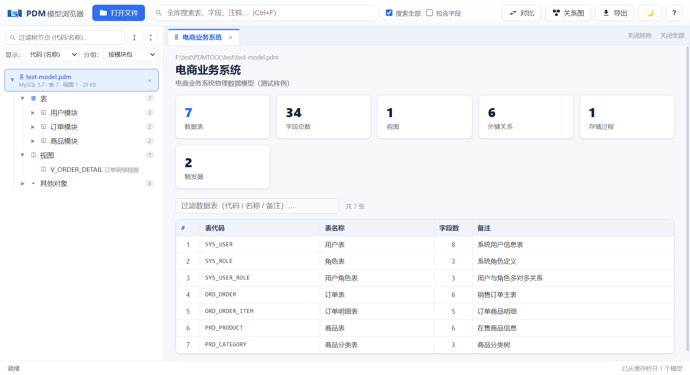
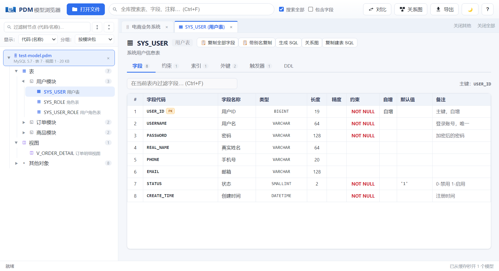

# PDM模型浏览器 (PDMTOOL)

PowerDesigner PDM 数据模型浏览工具 —— 专注提供快速、轻量、直观的 PDM 模型浏览、多模型对比与数据字典导出体验。

---

## ✨ 核心特性

- ⚡ **轻量秒开**：无需安装庞大的 PowerDesigner，即可极速打开并解析 `.pdm` 模型文件，内置解析缓存机制。
- 🔍 **全局精准检索**：支持跨模型/单模型搜索，全量检索表名、表注释、字段名、字段注释与编码。
- 📊 **丰富的数据字典导出**：
  - 支持单表 / 整个模型 / 自定义勾选批量导出
  - 支持格式：交互式 HTML、Word (.doc)、Excel (.xls)、Markdown (.md)、CSV、建表 DDL SQL
- ⚖️ **模型版本对比**：内置模型 Diff 差异比对，直观查看两个版本之间新增、删除、修改的表与字段。
- 🖼️ **ER 关系图查看**：可视化展示实体间外键关联关系与依赖结构。
- 📑 **多标签页与状态记忆**：支持多文件同时打开切换，自动记忆窗口大小、历史记录与工作区状态。

---

## 📸 界面预览

### 模型概览


### 数据表详情与字段结构


---

## 📥 下载与安装

请前往 [Releases 页面](https://github.com/CGW-Dev1/pdmtool/releases) 下载最新的 Windows 安装包：

- **PDM模型浏览器 Setup 1.4.1.exe**（Windows 64位 NSIS 安装包）

---

## 🛠️ 技术栈

- **框架**：[Electron](https://www.electronjs.org/)
- **打包工具**：[electron-builder](https://www.electron.build/)
- **核心解析**：基于原生纯 JavaScript 实现高效流式/DOM XML 解析

---

## 💻 本地开发

### 环境要求

- Node.js >= 18
- npm / yarn / pnpm

### 安装依赖

```bash
npm install
```

### 启动开发环境

```bash
npm start
```

### 构建打包

```bash
npm run dist
```

打包完成后，安装包将输出至 `dist/` 目录。

---

## 📄 开源许可

本项目基于 [MIT License](LICENSE) 开源。
