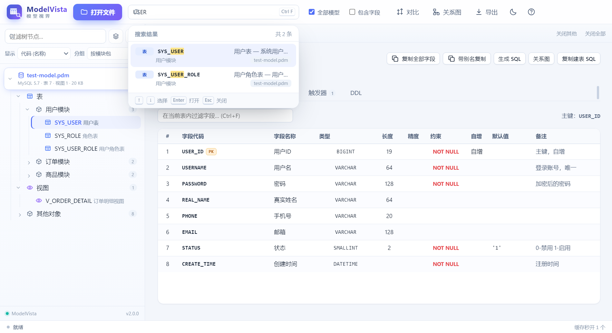
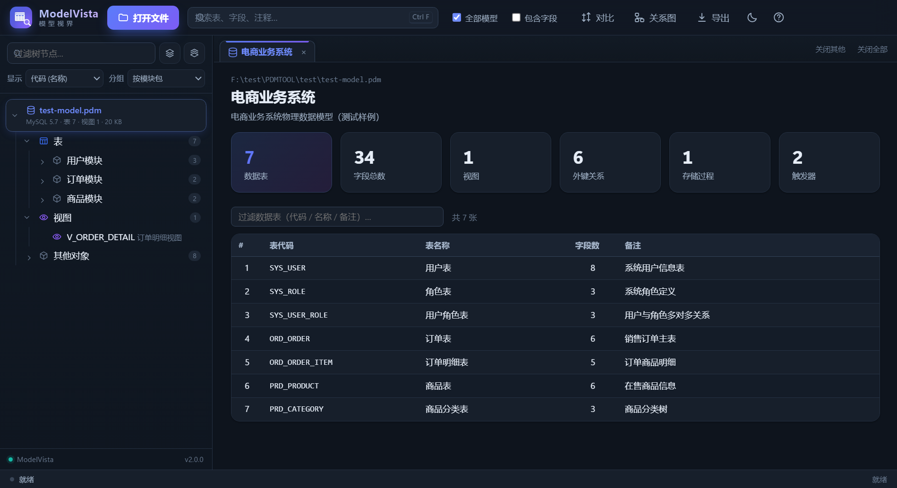

# ModelVista 模型视界

> 轻快、优雅的 PowerDesigner PDM 数据模型浏览器与数据字典工具。

ModelVista 让你无需安装庞大的 PowerDesigner，就能快速打开 `.pdm` 数据模型，浏览表结构、全局检索、对比模型差异、查看 ER 关系图，并一键导出漂亮的数据字典。

---

## ✨ 核心特性

- **秒开模型**：原生 XML 解析 + 智能解析缓存，第二次打开几乎瞬时完成。
- **全局检索**：跨模型搜索表名、字段名、代码与注释，支持键盘上下选择、回车直达。
- **完整表结构**：字段精度、主键 / 外键标记、约束、索引、触发器、视图与存储过程，一应俱全。
- **多方言 DDL**：MySQL、Oracle、PostgreSQL、SQL Server、达梦（DM）建表脚本随时生成。
- **模型对比**：选择两个模型，一键定位新增 / 删除 / 修改的表与字段，可导出 Markdown 报告。
- **ER 关系图**：以任意表为中心展示父子关系，支持平移缩放与 PNG 导出。
- **多格式导出**：交互式 HTML、Word、Excel、Markdown、CSV、SQL、PDF，支持整模型或自定义勾选。
- **桌面级体验**：多标签页、深色 / 浅色主题、拖拽打开、文件变更自动提醒、窗口与侧栏宽度记忆。
- **文件关联**：安装版可直接双击 `.pdm` 文件打开，也可作为“打开方式”的默认程序。

## 📸 界面预览

### 欢迎页


### 模型概览


### 表结构视图


### 全局搜索



### 深色主题



---

## 📥 下载与安装

前往 [Releases 页面](https://github.com/CGW-Dev1/model-vista/releases) 下载最新版本（v2.0.0），提供三种产物：

| 产物 | 文件名 | 适用场景 |
| --- | --- | --- |
| 安装版（Setup） | `ModelVista-2.0.0-Setup.exe` | 推荐。安装到本机、创建开始菜单与桌面快捷方式、注册 `.pdm` 文件关联 |
| 单文件便携版 | `ModelVista-2.0.0-Portable.exe` | 单个 exe，双击即用，不写注册表，适合放在 U 盘或临时机器 |
| 解压即用版 | `ModelVista-2.0.0-Portable.zip` | 解压到任意目录后运行 `ModelVista.exe`，适合绿色部署 / 内网分发 |

> 便携版与 zip 版不会自动注册 `.pdm` 文件关联，需要时可将 `ModelVista.exe` 手动设为“打开方式”。

**系统要求**：Windows 10 1809+ / Windows 11，64 位。

### 📊 性能与体积

- 冷启动首屏约 **0.5 秒**（本机实测），二次打开模型走解析缓存，几乎没有等待。
- 安装包约 **71 MB**，相比上一代 82 MB 缩小约 **13%**（仅保留中英两套 Electron 语言包 + maximum 压缩）。
- 应用本体（`app.asar`）约 **0.4 MB**，无前端框架、无运行时依赖。

---

## 🛠️ 技术栈

- [Electron](https://www.electronjs.org/) 33
- 原生 JavaScript（无前端框架，启动开销极低）
- [electron-builder](https://www.electron.build/) 打包

## 💻 本地开发

```bash
npm install       # 安装依赖
npm start         # 启动开发环境
npm run test:e2e  # 运行内置 E2E 测试（50 项链路校验）
npm run dist:all  # 一次构建 Setup / Portable / Zip 三种产物
```

构建产物输出到 `dist/` 目录。

## 📁 项目结构

```
main.js               Electron 主进程：窗口、菜单、IPC、解析缓存、PDF 导出
preload.js            安全的渲染进程桥接层
src/
  index.html          应用壳与图标库
  css/app.css         设计系统与全部界面样式
  js/pdm-parser.js    PDM（XML）解析器
  js/exporter.js      数据字典导出（HTML/Word/Excel/Markdown/CSV/SQL）
  js/diagram.js       ER 关系图（SVG）
  js/diff.js          模型差异对比
  js/app.js           渲染进程主逻辑
resources/            应用图标
test/                 测试样例、E2E 与截图脚本
```

## 📄 开源许可

本项目基于 [MIT License](LICENSE) 开源。
